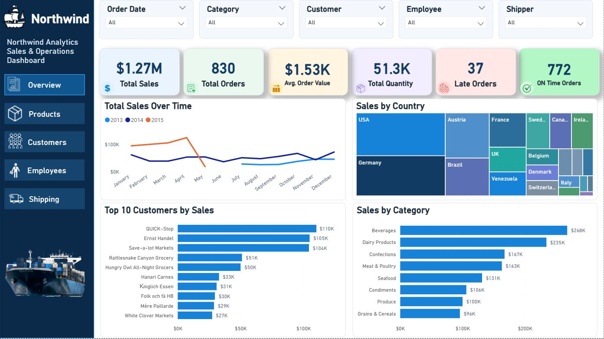
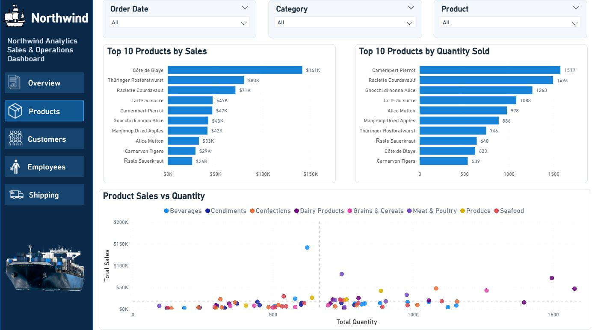
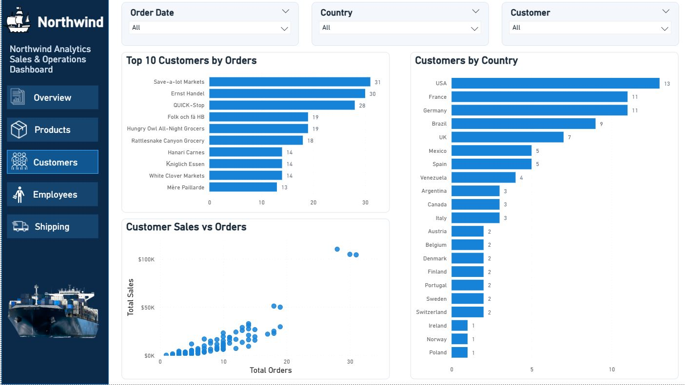
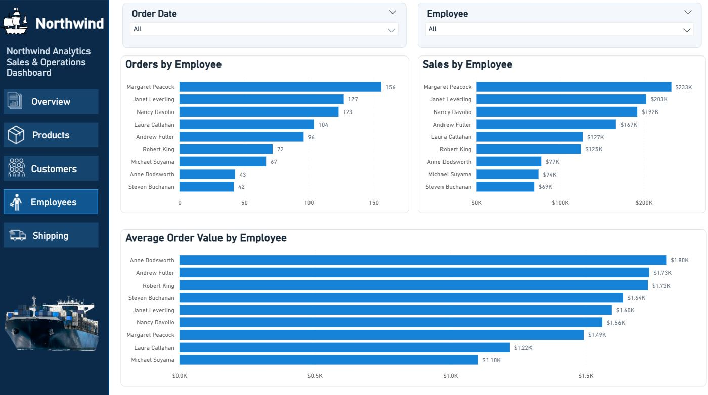
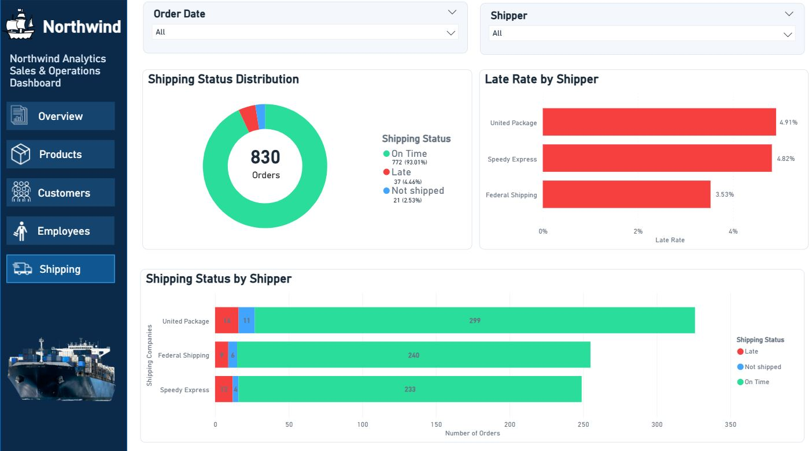

# Northwind Sales & Operations Analysis

## Project Overview
This project analyzes the Northwind dataset to explore sales performance, customer behavior, product demand, employee performance, and shipping operations.

The project combines SQL, Python, and Power BI to transform raw data into useful business insights.

## Tools & Technologies
- **SQL:** Data querying, aggregations, joins, and business analysis.
- **Python:** Data exploration and analysis using Pandas and other relevant libraries.
- **Power BI:** Interactive dashboard development and data visualization.

## Project Structure
- data/ — Contains the CSV files used for the analysis.

- images/ — Contains screenshots of the five Power BI dashboard pages.

- Data_Analysis_Project_sq.sql — SQL queries for sales and operations analysis.

- analysis.ipynb — Python notebook for data exploration and analysis.

- the_big_power_pi_project.pbix — Power BI dashboard file.

- README.md — Project overview, documentation, and dashboard screenshots.
## Dashboard Pages
The Power BI dashboard contains five pages:

1. **Overview** — Overall business performance.
2. **Products** — Product demand and sales analysis.
3. **Customers** — Customer-related analysis.
4. **Employees** — Employee order performance.
5. **Shipping** — Shipping status and delivery performance.

## Key Findings
- Total orders analyzed: **830**
- On-time orders: **772**
- Late orders: **37**
- Unshipped orders: **21**

## Dashboard Screenshots

## How to Explore
1. Open the SQL file to review the analysis queries.
2. Open the Python notebook to explore the data analysis.
3. Open the Power BI `.pbix` file using Power BI Desktop to interact with the dashboard.

## Dataset
The project uses the Northwind sample dataset, consisting of customer, employee, product, category, order, order-detail, and shipper data.

---

